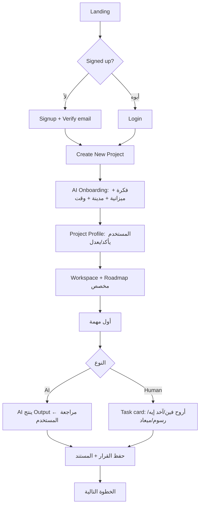
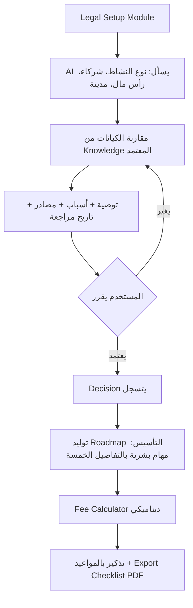
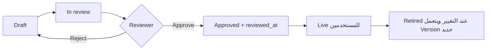
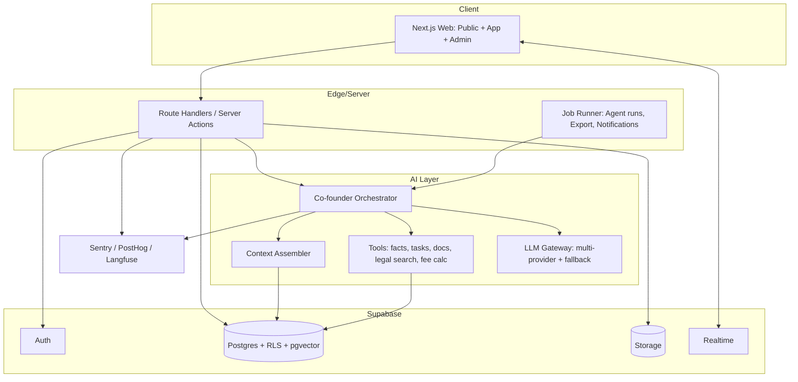

# Website Spec — سِكّة / SEKKA (AI Co-founder)

> Engineering Handoff · v1.1 · 25 Nov 2026 · Status: Draft for build kickoff
> v1.1: اتحسم الاسم (سِكّة / SEKKA)، الستايل (Blueprint × Arabic Geometric)، والباليت (Tile and Terracotta)
> المصدر: Project Handoff — AI Co-founder + قرارات النقاش الأخير

---

## 0. إزاي تقرا الملف ده

الملف ده بيغطي **الـ Website كله من A to Z**: Public Site + Auth + Application + Admin. مش معناه إن كل حاجة فيه تتبني مرة واحدة. **Section 19** بيقسم البناء على مراحل، والـ Strategy بتقول: نبدأ بشريحة رفيعة (Workspace + AI Co-founder + Legal Setup مصري) ونثبت الطلب قبل ما نوسّع.

### Legend

| Tag | المعنى |
|---|---|
| **[متفق]** | قرار معتمد |
| **[بريف]** | وارد في البريف الأصلي، مش قرار نهائي |
| **[اقتراح]** | توصية في الملف ده، محتاجة موافقة |
| **[بحث]** | محتاج تحقق أو بحث قبل ما نعتمد عليه |
| **[قرار]** | محتاج قرار من صاحب المشروع |

### قواعد عامة للمهندس

1. **الاسم المعتمد مبدئيًا: سِكّة / SEKKA** (لسه محتاج فحص Domain وTrademark). كل اسم/لوجو/لون يتقرا من ملف config واحد (`brand.config.ts` + design tokens)، وتغيير أي حاجة فيهم لازم يبقى تعديل في مكان واحد.
2. **اللغة العربية RTL هي الأساس**، مش ترجمة. الإنجليزية لاحقًا، بس البنية تدعمها من أول يوم (Section 12).
3. **مفيش رقم أو معلومة قانونية تتكتب hardcoded في الـ UI.** كل ده بييجي من الـ Knowledge/Legal tables المراجعة (Section 13.6, 14).
4. لو حاجة في الملف دي مش واضحة أو بتتعارض مع الواقع التقني، **اسأل واقترح بديل مع السبب**، متنفذش بصمت.

---

## 1. الموقع في سطرين

منصة SaaS عربية، الـ AI هو الـ Core Engine فيها، بتشتغل كـ "شريك مؤسس" بيمشي مع المستخدم من الفكرة للتأسيس للإطلاق للنمو، جوه **Workspace مستقلة لكل مشروع** بتحتفظ بالسياق والقرارات والمهام والمستندات.

### أهداف الموقع

| السطح | الهدف | مؤشر النجاح [اقتراح] |
|---|---|---|
| Public Site | يفهّم القيمة بسرعة ويجمع Leads/تسجيلات | Waitlist conversion، Time-to-understand |
| Auth | تسجيل بأقل احتكاك | Signup completion rate |
| Application | المستخدم يكمل Onboarding ويبدأ أول مهمة | Activation، Task completion |
| Admin | فريقنا يدير المحتوى القانوني والاستهلاك والجودة | زمن تحديث محتوى قانوني |

### Non-goals (في النسخة الأولى)

- مفيش واجهة إنجليزية.
- مفيش Brand/Logo generation أو Website builder أو Social scheduling أو Investor CRM داخل التطبيق.
- مفيش دفع حقيقي (Free plan بحدود استخدام) [اقتراح].
- مفيش تطبيق Mobile Native. الموقع Responsive/PWA-ready بس.

---

## 2. Brand Identity

### 2.1 الاسم والشعار [متفق: اختيار صاحب المشروع]

| | |
|---|---|
| **الاسم** | **سِكّة** · SEKKA |
| **الشعار العربي** | من الفكرة.. للسِكّة الصح. |
| **الشعار الإنجليزي** | Build what you believe in. |
| **المعنى** | السِكّة = الطريق والمسار. الاسم بيقول إن المنتج بيمشّي المؤسس من أول الفكرة لحد الطريق الصح، واللعب بالكلمة في الشعار جزء من الشخصية |

**نقاط لازم تتفحص قبل الاعتماد النهائي [بحث]:**

- [ ] Domain: `.com` + `.com.eg` + بدائل، وSocial handles (Facebook / Instagram / TikTok / X / LinkedIn)
- [ ] بحث Trademark في مصر (مراجعة قانونية)
- [ ] وجود براند بنفس الاسم أو قريب منه في المجال نفسه (Sekka/Sikka)
- [ ] ارتباطات الكلمة: "سِكّة حديد" (مواصلات) و"سِكّة" بمعنى العملة. الحل: السياق البصري والشعار يثبّتوا المعنى (طريق ومسار)، والـ Tagline يظهر مع الاسم في الأماكن الأولى
- [ ] اختبار النطق والفهم مع 10 أشخاص من لهجات مختلفة (المصري "سِكّة"، والكتابة اللاتينية الثابتة: **Sekka**)

### 2.2 Brand Personality

| الصفة | معناها في التنفيذ |
|---|---|
| عملي | كل شاشة بتخلّي المستخدم يعمل حاجة، مش بتبهره بس |
| مباشر وواثق | جمل قصيرة، مفيش مبالغة، مفيش وعود فاضية |
| دافي ومصري | قريب من المستخدم، وبيتكلم بلغته |
| دقيق | زي رسم هندسي: كل رقم وكل خطوة ليها أساس |
| صادق | بيقول "ده افتراض" و"ده محتاج مراجعة" بدل ما يخمّن |

### 2.3 Tone of Voice

- **UI/Product:** عربي بسيط وواضح، قريب من المصري بدون عامية تقيلة. [اقتراح]
- **Marketing headlines:** نبرة مصرية أخف وأقرب (زي الشعار). [قرار]
- ممنوع: "حلول مبتكرة"، "ثورة"، "نقلة نوعية"، كلام marketing فاضي.
- الأرقام والأسعار والإجراءات: دايمًا بمصدر أو بعلامة "افتراض".

| بدل | قول |
|---|---|
| "نقدم لك حلولًا متكاملة لريادة الأعمال" | "ابدأ مشروعك من الفكرة لحد التأسيس، وسِكّة معاك في كل خطوة" |
| "حدث خطأ غير متوقع" | "حصلت مشكلة من عندنا. جرّب تاني بعد شوية" |

### 2.4 Visual Direction: "Blueprint × Arabic Geometric" [متفق على الاتجاه]

**الفكرة:** طاولة رسم هندسي بروح عربية. الـ Blueprint بيدّي الشبكة وخطوط القياس والتعليقات بخط Mono، والزخرفة العربية الهندسية أصلًا بتتبني بالبركار والمسطرة، فبنستخدم **نفس خطوط الإنشاء (Construction lines)** كلغة بصرية واحدة. المسار (السِكّة) هو الخط اللي بيكمّل من نقطة البداية للنجمة.

**العناصر الأساسية:**

| العنصر | الوصف | الاستخدام |
|---|---|---|
| **Blueprint Grid** | شبكة خطوط رفيعة جدًا بلون `--grid-line` | خلفية الـ Hero وأقسام تسويقية مختارة، وحالات الـ Empty/Onboarding |
| **Construction Lines** | خطوط ودواير مساعدة بتظهر وهي بتبني الشكل | اللوجو، اللودينج، وحالة "الـ AI بيفكر" |
| **النجمة الثمانية (Khatam)** | مربعين متراكبين بدوران 45° وبداخل دايرة | فواصل الأقسام، Bullets مميزة، علامة النجاح والإنجاز |
| **Dimension & Annotation** | علامات قياس وتعليقات Mono زي `FIG. 01` و`01 / 06` | ترقيم الخطوات، عناوين فرعية، Labels |
| **Title Block** | مربع معلومات زي اللي في زاوية الرسم الهندسي | **عنصر وظيفي:** بيعرض في المحتوى القانوني (المصدر الرسمي، تاريخ المراجعة، رقم النسخة) وفي Task cards |
| **Registration Marks** | علامات الزوايا (Crop marks) | إطار الـ ProductFrame وكروت المستندات |

**قواعد التنفيذ:**

1. **الستايل وظيفي مش زخرفة.** الشبكة والنجمة في الموقع التسويقي بحضور واضح، لكن **جوه التطبيق** (Dashboard / Workspace) تفضل هادية: خلفية سادة، وخطوط وعناصر الستايل بس في Empty states وOnboarding والـ Title Block.
2. أي Pattern خلف نص لازم يحافظ على الـ Contrast (الشبكة خفيفة، ومفيش Pattern تحت فقرات طويلة).
3. **Motion بمعنى:** خطوط الإنشاء بترسم النجمة (لودينج، تفكير الـ AI)، مع بديل ثابت لـ `prefers-reduced-motion`.
4. الزخرفة **هندسية معاصرة**، مفيش رموز أو خطوط دينية أو نصوص مقدسة كعناصر تزيينية.
5. Radii صغيرة وحدود 1px واضحة (إحساس رسم هندسي)، مفيش Shadows تقيلة.

**ممنوع:** Gradient blobs، Glassmorphism، أيقونات 3D، Stock illustrations، شبكات كروت متطابقة متكررة، Dark mode "نيون".

### 2.5 Logo Direction

- **Primary:** Wordmark عربي مخصّص لـ **سِكّة** (شدّة الكاف عنصر مميز في الشكل) كأساس، والنسخة اللاتينية **SEKKA** تابعة لها.
- **Mark:** خط مسار واحد متصل بيبدأ من نقطة (الفكرة)، ويلف بزوايا 45°/90° (لغة الـ Blueprint) لحد ما يوصل لرأس نجمة ثمانية. نفس الفكرة: السِكّة اللي بتوصل.
- **شروط تقنية:** يشتغل بوضوح على 16px (favicon)، أحادي اللون، فاتح وغامق، ونسخة أفقية ونسخة مربعة (Avatar).
- **النسخة المتحركة:** الـ Mark بيترسم بخطوط الإنشاء (للـ Splash واللودينج).
- **Deliverables من المصمم:** SVG (primary, mono, reversed)، favicon set، OG image template، Brand guidelines مختصرة.
- الـ AI Co-founder نفسه ليه علامة صغيرة موحدة (النجمة الثمانية المبسطة بلون `--highlight`) في كل الواجهة، مفيش Avatar كارتوني ولا "روبوت".

---

## 3. Color System: Tile and Terracotta [متفق على الباليت]

> الباليت دي اختيار صاحب المشروع. القيم المشتقة (Surfaces، Semantic، Dark theme) **اقتراح** لازم يتفحص Contrast بأداة قبل الاعتماد (الهدف WCAG 2.2 AA كحد أدنى).

### 3.1 الألوان الأساسية (الباليت الأصلية)

| الاسم | Hex | الدور |
|---|---|---|
| Ink (حبر أخضر غامق) | `#0E3B3A` | النص والعناوين وخطوط الرسم الأساسية |
| Paper (ورق عاجي) | `#F4EEE2` | الخلفية |
| Line (خط الشبكة) | `#B9C9C3` | الـ Blueprint Grid والحدود الخفيفة |
| Terracotta (تيراكوتا) | `#C8553D` | **زخرفة وعناوين كبيرة وخطوط إنشاء** (مش نص صغير ولا نص زرار) |
| Sand (رملي) | `#D8B98A` | تمييز ثانوي، علامة الـ AI، Progress |

### 3.2 نقطة Accessibility مهمة

التيراكوتا `#C8553D` على الورق العاجي نسبة التباين فيها حوالي **3.8:1**، وده مقبول للنص الكبير والعناصر الزخرفية فقط، ومش للنص الصغير أو نص الزرار (الحد 4.5:1). عشان كده فيه **درجتين**:

- `--primary` = **`#B5472F`** (تيراكوتا غامق) لأي فعل أو نص أو لينك (تباين تقريبي 4.6:1 على الورق و5.4:1 مع نص أبيض).
- `--terracotta-decor` = `#C8553D` للزخرفة والعناوين الكبيرة بس.

لون الـ Error (`--danger`) مختلف عن الـ Primary عمدًا، ومعاه دايمًا أيقونة ونص، عشان التيراكوتا والأحمر ميتلخبطوش.

### 3.3 Light Theme (الافتراضي)

| Token | Hex | الاستخدام |
|---|---|---|
| `--bg` | `#F4EEE2` | خلفية الصفحة (Paper) |
| `--surface` | `#FBF8F1` | Cards، Inputs، Modals |
| `--surface-muted` | `#EAE2D2` | أقسام ثانوية، Table headers |
| `--border` | `#D8D0BE` | الحدود والفواصل |
| `--grid-line` | `#B9C9C3` | الـ Blueprint Grid (زخرفي) |
| `--text` | `#0E3B3A` | النص الأساسي (Ink) |
| `--text-muted` | `#4F6563` | نص ثانوي |
| `--primary` | `#B5472F` | الأفعال الأساسية |
| `--primary-hover` | `#9A3B26` | Hover/Pressed |
| `--primary-contrast` | `#FFFFFF` | نص فوق Primary |
| `--terracotta-decor` | `#C8553D` | زخرفة وعناوين كبيرة فقط |
| `--highlight` | `#D8B98A` | علامة الـ AI، Progress، تمييز (مش نص) |
| `--success` | `#1F7A44` | نجاح |
| `--warning` | `#8A5A00` | تحذير |
| `--danger` | `#B3261E` | خطأ/حذف |
| `--info` | `#245C8A` | معلومة |

### 3.4 Dark Theme

| Token | Hex |
|---|---|
| `--bg` | `#0A1C1B` |
| `--surface` | `#102726` |
| `--surface-muted` | `#163230` |
| `--border` | `#274543` |
| `--grid-line` | `#1E3A38` |
| `--text` | `#F1EADB` |
| `--text-muted` | `#A9B8B3` |
| `--primary` | `#E8795E` |
| `--primary-hover` | `#F08C72` |
| `--primary-contrast` | `#0A1C1B` |
| `--terracotta-decor` | `#C8553D` |
| `--highlight` | `#E2C79A` |
| `--success` | `#5CC28A` |
| `--warning` | `#E0A84A` |
| `--danger` | `#F07A70` |
| `--info` | `#7FB2E0` |

### 3.5 قواعد الاستخدام

- **Primary** للأفعال فقط (Buttons، Links، Focus). متتحطش كزخرفة.
- **Terracotta decor** للعناوين الكبيرة وخطوط الإنشاء والنجمة، مرة أو مرتين في الشاشة.
- **Sand/Highlight** نادر: علامة الـ AI، Progress، لحظة إنجاز. مش للنص.
- المعنى مايعتمدش على اللون وحده: كل Status فيه أيقونة/نص/شكل.
- **مهام الـ AI vs مهام الإنسان** تتفرق بشكل Chip وأيقونة ونص ("ينفذها AI" / "عليك أنت").
- Theme switching: يحترم `prefers-color-scheme` ومعاه Toggle يدوي ويتحفظ.
- مفيش Gradients في الـ UI.

```css
:root {
  --bg: #F4EEE2; --surface: #FBF8F1; --surface-muted: #EAE2D2;
  --border: #D8D0BE; --grid-line: #B9C9C3;
  --text: #0E3B3A; --text-muted: #4F6563;
  --primary: #B5472F; --primary-hover: #9A3B26; --primary-contrast: #FFFFFF;
  --terracotta-decor: #C8553D; --highlight: #D8B98A;
  --success: #1F7A44; --warning: #8A5A00; --danger: #B3261E; --info: #245C8A;
  color-scheme: light;
}
:root[data-theme="dark"] {
  --bg: #0A1C1B; --surface: #102726; --surface-muted: #163230;
  --border: #274543; --grid-line: #1E3A38;
  --text: #F1EADB; --text-muted: #A9B8B3;
  --primary: #E8795E; --primary-hover: #F08C72; --primary-contrast: #0A1C1B;
  --terracotta-decor: #C8553D; --highlight: #E2C79A;
  --success: #5CC28A; --warning: #E0A84A; --danger: #F07A70; --info: #7FB2E0;
  color-scheme: dark;
}
```

---

## 4. Typography

### 4.1 الخطوط [اقتراح]

| الدور | الخط | ليه |
|---|---|---|
| UI + Body (عربي + لاتيني) | **IBM Plex Sans Arabic** | عربي ولاتيني متناسقين في عائلة واحدة، مقروء في الأحجام الصغيرة، مناسب للـ Dashboard |
| Headings / Display | **Readex Pro** (بديل: Alexandria أو Noto Kufi Arabic) | شخصية أوضح للعناوين مع حفاظ على الوضوح |
| أرقام/Code/IDs + تعليقات الـ Blueprint | **IBM Plex Mono** | الـ IDs والأرقام الجدولية، وكمان التعليقات الفنية (`FIG. 01`، `01 / 06`، قياسات) اللي بتدّي إحساس الرسم الهندسي |

- **اختبار قبل الاعتماد:** المصمم يجرب العناوين بالبدائل في Figma على Hero حقيقي، ونثبت الاختيار. [قرار]
- كل الخطوط **Self-hosted** (عن طريق `next/font`)، Subset (Arabic + Latin)، `font-display: swap`.
- **حد الأوزان:** 3 أوزان بالكتير للعائلة (400 / 500 / 600) لحماية الـ Performance.
- تأكد من ترخيص كل خط للاستخدام التجاري قبل الاعتماد. [بحث]

### 4.2 Type Scale (Desktop / Mobile)

الخط العربي محتاج حجم وارتفاع سطر أكبر من اللاتيني.

| Style | Desktop | Mobile | Line-height | Weight |
|---|---|---|---|---|
| Display | 56px | 36px | 1.25 | 600 |
| H1 | 44px | 30px | 1.3 | 600 |
| H2 | 32px | 24px | 1.35 | 600 |
| H3 | 24px | 20px | 1.4 | 600 |
| Body L | 19px | 17px | 1.8 | 400 |
| Body | 17px | 16px | 1.75 | 400 |
| Small | 14px | 14px | 1.6 | 400 |
| Caption/Label | 13px | 13px | 1.5 | 500 |

### 4.3 قواعد عربي/RTL

- **الأرقام:** Western digits (0–9) كافتراضي [اقتراح]، مع `font-variant-numeric: tabular-nums` في الجداول والأسعار. الفورمات عبر `Intl.NumberFormat('ar-EG-u-nu-latn', ...)`.
- **العملة:** `EGP` تظهر "ج.م" بصيغة موحدة في كل التطبيق.
- **التواريخ:** ميلادي، وأسبوع العمل في التقويم يبدأ **السبت**.
- **نص مختلط (عربي + إنجليزي):** استخدم `<bdi>` أو `dir="auto"` حول أي نص لاتيني أو رقم مستخدم داخل جملة عربية (أسماء براندات، URLs، أكواد).
- متستخدمش letter-spacing على العربي أبدًا (بيكسر الاتصال بين الحروف).
- متستخدمش Italic للعربي. للتشديد استخدم الوزن.
- Truncation: `text-overflow: ellipsis` بيشتغل صح RTL، لكن اختبره على الأسماء الطويلة.

---

## 5. Design System Foundations

### 5.1 Tokens

| Category | Value [اقتراح] |
|---|---|
| Spacing | Scale على 4px: 4, 8, 12, 16, 24, 32, 48, 64, 96 |
| Radius | sm 2 · md 4 · lg 8 · full (Chips/Avatars بس). صغيرة عمدًا، إحساس رسم هندسي |
| Elevation | حدود 1px واضحة أولًا، Shadow خفيف جدًا للـ Modals/Popovers بس |
| Container | Marketing: max 1200px · App content: max 1440px · Reading (Resources): 720px |
| Breakpoints | `sm 640` · `md 768` · `lg 1024` · `xl 1280` |
| Motion | 150ms (micro) · 250ms (layout) · easing واحد موحد · يحترم `prefers-reduced-motion` |
| Icons | مكتبة واحدة (Lucide)، Stroke 1.5–2px |

### 5.2 قواعد RTL إلزامية

- **Logical properties فقط:** `ms-*` `me-*` `ps-*` `pe-*` `start/end` `text-start`، ممنوع `ml/mr/pl/pr/left/right` في الكود (يتفرض بـ ESLint rule).
- `<html lang="ar" dir="rtl">` على مستوى الـ root.
- **الأيقونات اللي تتقلب في RTL:** الأسهم، Chevrons، Back/Forward، Progress direction.
- **متتقلبش:** Play/Media، Logos، الأرقام، Checkmarks، أيقونات الساعة.
- Sliders وProgress bars بتتحرك من اليمين لليسار.
- كل Component لازم يتجرب RTL + Dark + Mobile قبل ما يتقفل.

### 5.3 Component Inventory

مبني على **shadcn/ui + Radix primitives** (مع مراجعة RTL لكل Component) [اقتراح].

| المجموعة | Components |
|---|---|
| Base | Button, IconButton, Input, Textarea, Select, Combobox, Checkbox, Radio, Switch, Tabs, Tooltip, Popover, Dialog, Sheet/Drawer, Dropdown, Toast, Skeleton, Badge/Chip, Avatar, Table, Pagination |
| App | AppShell (Sidebar + Topbar), ProjectSwitcher, EmptyState, StatusPill, ProgressStepper, CommandPalette (Cmd+K) |
| AI | ChatThread, MessageBubble (user/AI), StreamingText, ToolCallCard, SuggestionChips, ThinkingIndicator, SourceCitation, ConfirmFactCard |
| Work | TaskCard (AI/Human), MilestoneTimeline, DecisionLogItem, DocumentEditor, DocumentVersionList, FileUploader, DeadlineBadge |
| Brand | BlueprintGrid (SVG pattern)، StarConstruction (نجمة بترسم نفسها، مع بديل ثابت)، TitleBlock (المصدر + تاريخ المراجعة + النسخة)، DimensionLabel، RegistrationMarks |
| Marketing | Hero, SectionHeader, StepsTimeline, ProductFrame (إطار لعرض UI حقيقي)، PricingTable, FAQAccordion, LeadForm, Footer |

---

## 6. Sitemap

### 6.1 Public Site

```
/                         Home
/how-it-works             How It Works
/features                 Features
/pricing                  Pricing
/resources                Knowledge Hub (index)
/resources/[slug]         مقال/دليل
/about                    About
/faq                      FAQ
/contact                  Contact
/terms                    Terms & Conditions
/privacy                  Privacy Policy
/waitlist                 Waitlist (Phase 0، ممكن يكون الـ Home نفسه)
```

### 6.2 Authentication

```
/signup   /login   /forgot-password   /reset-password   /verify-email
```

### 6.3 Application (يتطلب Login)

```
/app                                  Main Dashboard (كل المشاريع + ملخص)
/app/projects                         My Projects
/app/projects/new                     Create New Project (Onboarding مع الـ AI)
/app/p/[projectId]                    Project Overview
/app/p/[projectId]/cofounder          AI Co-founder Interface
/app/p/[projectId]/roadmap            Project Roadmap
/app/p/[projectId]/modules/[key]      Module Page (legal-setup, validation, ...)
/app/p/[projectId]/tasks              Tasks & Milestones
/app/p/[projectId]/documents          Documents Library
/app/p/[projectId]/documents/[docId]  Document Editor/Viewer
/app/p/[projectId]/calendar           Calendar & Deadlines
/app/p/[projectId]/decisions          Decision Log
/app/p/[projectId]/settings           Project Settings
/app/notifications                    Notifications
/app/billing                          Credits & Billing
/app/settings                         Profile & Account Settings
```

### 6.4 Admin (Role = admin)

```
/admin                      Overview
/admin/users                المستخدمين
/admin/projects             المشاريع (read-only غالبًا)
/admin/usage                استهلاك AI والـ Credits
/admin/legal                المحتوى القانوني (Review workflow)
/admin/legal/sources        مصادر البيانات
/admin/ai-review            مراجعة إجابات AI (Sampling + Flags)
/admin/fees                 تحديث الرسوم والإجراءات
/admin/leads                Waitlist + Contact messages
/admin/health               جودة النظام والأخطاء
```

---

## 7. Page Specs: Public Site

### 7.1 Home (`/`)

الترتيب بالضبط، وكل قسم ليه هدف واحد:

| # | القسم | المحتوى | ملاحظات تنفيذ |
|---|---|---|---|
| 1 | Nav | Logo، How it works، Features، Pricing، Resources، Login، CTA | Sticky، يتحول لـ Drawer في Mobile |
| 2 | **Hero** | Headline + Subhead + CTA أساسي وثانوي + **ProductFrame** بيعرض واجهة حقيقية (محادثة + Roadmap) فوق Blueprint Grid، ونجمة بتترسم بخطوط الإنشاء | LCP element متحسّن، مفيش Illustration، الشبكة SVG خفيفة |
| 3 | المشكلة | قبل/بعد: أدوات متفرقة وتوهان ضد مكان واحد بيفتكر | Split layout مش Cards |
| 4 | How it works | 3 خطوات: احكي فكرتك، AI يبني خطتك، نفّذ معاه خطوة بخطوة | Timeline أفقي/رأسي |
| 5 | رحلة المشروع | مراحل الرحلة (التسعة)، المتاح حاليًا مفعّل والباقي "قريبًا" | Timeline تفاعلي، صدق في الحالة |
| 6 | الـ Workspace | مشروع = مساحة عمل مستقلة (قرارات، مستندات، مهام) | Tabs أو Screenshot متحرك |
| 7 | قدرات الـ AI | مثال محادثة حقيقي: يسأل، يحلل، يقترح، يحوّل لمهام | Chat مصطنع بنص ثابت، مش Lottie |
| 8 | التأسيس في مصر | Task card مثال بشكل **Title Block** (أروح فين، آخد إيه، رسوم، ميعاد، المصدر، تاريخ المراجعة) | **القيم placeholders**، متتكتبش أرقام حقيقية غير من الـ Knowledge المراجعة |
| 9 | الثقة | "مبنخترعش أرقام"، "المحتوى القانوني متراجع وبتاريخ"، "القرار دايمًا ليك" | 3 التزامات قصيرة |
| 10 | Pricing teaser | الخطة المجانية وحدودها | يرجع لـ `/pricing` |
| 11 | FAQ مختصر | 5–6 أسئلة | FAQPage JSON-LD |
| 12 | CTA ختامي | تكرار العرض الأساسي | |
| 13 | Footer | روابط، Legal، تواصل | |

**Hero copy (مسودة، Appendix A):** "من الفكرة.. للسِكّة الصح." · EN: "Build what you believe in."

### 7.2 How It Works (`/how-it-works`)
رحلة المستخدم من الفكرة للإطلاق في 6–8 خطوات، كل خطوة بـ Screenshot/ProductFrame وجملة واحدة، وبتنتهي بـ CTA.

### 7.3 Features (`/features`)
تنظيم حسب مراحل الرحلة (مش قايمة أدوات). كل Module فيه: بيعمل إيه، مخرجاته، حالته (متاح / قريبًا). **الصدق في الحالة إلزامي.**

### 7.4 Pricing (`/pricing`)
- الخطة المجانية: الحدود (عدد المشاريع، Credits شهرية، Export) **[قرار: الأرقام]**.
- الخطط المدفوعة: "قريبًا" مع Waitlist.
- قسم B2B للحاضنات والمسرعات: Form تواصل. [بريف]
- الأسعار مش متحسمة، فمنعرضش أي رقم دفع قبل القرار.

### 7.5 Resources / Knowledge Hub (`/resources`)
- Index بفلترة (تأسيس، قانوني، ضرائب، تسويق...) وبحث.
- Article template: عنوان، ملخص، **تاريخ آخر مراجعة**، المصدر الرسمي، المحتوى، CTA لبدء مشروع.
- أي محتوى قانوني/ضريبي لازم يعدّي نفس Review workflow بتاع الـ Admin.
- المحتوى يتخزن في الـ DB أو MDX [قرار]، توصيتي: **MDX في الريبو للمقالات + جدول Legal Knowledge منفصل للتطبيق**.

### 7.6 About / FAQ / Contact
- **About:** القصة والرؤية والالتزامات، مفيش ادعاءات غير مثبتة.
- **FAQ:** Accordion مجمّع بفئات، JSON-LD.
- **Contact:** Form (Name, Email, Subject, Message) + Turnstile/CAPTCHA + Rate limit، بيتخزن في `contact_messages` ويتبعت إيميل للفريق.

### 7.7 Terms & Privacy
صفحات نصية بتتكتب وتتراجع **قانونيًا** (متتولدش بالـ AI وتتنشر). [بحث]

### 7.8 Waitlist (Phase 0)
- Form: الاسم، الإيميل (أو واتساب)، "إيه الفكرة اللي عندك؟" (اختياري)، نوع المستخدم (Freelancer / طالب / صاحب مشروع صغير / غيره).
- بعد التسجيل: صفحة شكر + سؤال اختياري "ينفع نكلمك 15 دقيقة؟" (لتجنيد مقابلات الـ Phase 0).
- Consent صريح لاستخدام البيانات. Double opt-in [اقتراح].
- Events: `waitlist_view`, `waitlist_submit`, `interview_opt_in`.

---

## 8. Page Specs: Auth & Application

### 8.1 Auth
- **Signup:** Email + Password (والـ Google OAuth [اقتراح])، موافقة على Terms/Privacy، Verify email.
- **Login / Forgot / Reset:** Flows قياسية، رسائل خطأ عامة (متكشفش وجود الحساب).
- Rate limiting + Bot protection على كل Auth endpoints.
- بعد أول Login: يتوجه مباشرة لـ `/app/projects/new` لو معندوش مشاريع.

### 8.2 Dashboard (`/app`)
قايمة المشاريع بكروت مختصرة (الاسم، المرحلة، Progress، أقرب Deadline)، "الخطوة اللي AI بيقترحها دلوقتي" لكل مشروع، Credits المتبقية.

### 8.3 Create New Project (Onboarding)
محادثة مع الـ AI (مش Form طويل):
1. الفكرة (نص حر).
2. أسئلة ذكية: الميزانية، المدينة، الوقت المتاح، خبرة المستخدم، هل في شريك.
3. الـ AI بيلخص **Project Profile** والمستخدم **بيأكده/يعدله** (ConfirmFactCard).
4. يتحدد نوع المشروع ويتولد Workspace + Roadmap مخصص.
5. أول مهمة تظهر فورًا.

### 8.4 Project Workspace Shell
- **Sidebar:** Overview، Co-founder، Roadmap، Modules، Tasks، Documents، Calendar، Decisions، Settings.
- **Topbar:** Project Switcher، Search/Command palette، Notifications، Credits، Theme، Profile.
- **Mobile:** Bottom nav (Overview، Co-founder، Tasks، Documents، المزيد).
- بيانات مشروع واحد بس في أي لحظة، التبديل بين المشاريع بيمسح الـ cache المرتبط بالمشروع القديم.

### 8.5 AI Co-founder Interface
- Chat بـ Streaming، فوقه **Context bar** (اسم المشروع، المرحلة، الخطوة الحالية).
- AI بيبادر باقتراح "الخطوة الجاية" (Suggestion chips).
- أي حقيقة جديدة بيستخرجها (ميزانية، مدينة...) بتظهر كـ **ConfirmFactCard** قبل ما تتحفظ.
- نتائج الـ AI (مستند/مهام) بتظهر كـ Cards قابلة للفتح والتعديل، مش نص ضايع في الشات.
- أي إجابة قانونية: **SourceCitation + تاريخ المراجعة + Disclaimer** إلزاميين.
- حالات: Streaming، Error، Rate-limited، Out-of-credits، Offline.

### 8.6 Roadmap
Timeline مراحل المشروع (مولّدة من الـ Module manifest + سياق المشروع)، كل مرحلة فيها Milestones وProgress. المستخدم يقدر يعدل الترتيب ويطلب من الـ AI يعيد التخطيط.

### 8.7 Tasks & Milestones
- نوعين: **مهمة AI** (AI بيعملها وبيسلمها) و**مهمة بشرية** (عليك أنت).
- **كل مهمة بشرية قانونية لازم تعرض 5 حاجات:** أروح فين؟ أحتاج إيه؟ المستندات المطلوبة؟ الرسوم؟ الموعد النهائي؟ (+ رابط المصدر الرسمي وتاريخ المراجعة).
- Views: List، Board، By milestone. فلترة وStatuses (To do / In progress / Blocked / Done).

### 8.8 Documents Library
قايمة مستندات المشروع (نوع، آخر تعديل، Version). Editor نص غني (TipTap [اقتراح])، **Version history** (مين عدّل: AI/مستخدم)، Export PDF/DOCX، Upload ملفات.

### 8.9 Calendar & Deadlines
تقويم أسبوعي/شهري (الأسبوع يبدأ السبت)، مصدره Tasks + Milestones، تذكيرات.

### 8.10 Decision Log
كل قرار: العنوان، السبب، التاريخ، مين اتخذه، **supersedes** لو بيلغي قرار سابق. الـ AI بيراجع القرارات السابقة ويكشف التعارض.

### 8.11 Billing, Notifications, Settings
- **Credits & Billing:** الرصيد، سجل الاستهلاك (Ledger)، حدود الخطة، "قريبًا" للدفع.
- **Notifications:** In-app + إيميل (Deadlines، مهام، تحديثات قانونية).
- **Settings:** الملف الشخصي، اللغة، Theme، تصدير بياناتي، حذف الحساب.

### 8.12 Admin
شاشات Section 6.4. أهم Workflow: **Legal Content Review** (Draft ← In review ← Approved ← Retired) مع مراجع وتاريخ ومصدر رسمي لكل عنصر.

---

## 9. User Flows

### 9.1 الرحلة الأساسية



### 9.2 Legal Setup Flow (MVP)



### 9.3 Admin: Legal Content Review



---

## 10. Information Architecture

### 10.1 Navigation

| السياق | العناصر |
|---|---|
| Public (Header) | الرئيسية · كيف يعمل · المميزات · الأسعار · المصادر · دخول · **ابدأ مجانًا** |
| App (Account level) | Dashboard · المشاريع · الإشعارات · الرصيد · الإعدادات |
| App (Project level) | Overview · Co-founder · Roadmap · Modules · Tasks · Documents · Calendar · Decisions · Settings |
| Footer | Product · Resources · Company · Legal |

### 10.2 مستويات الكيانات

```
Account (User)
 └── Project (1..n)             ← حد العزل
      ├── Facts (Project Profile)
      ├── Decisions
      ├── Conversations ← Messages
      ├── Milestones ← Tasks
      ├── Documents ← Versions
      ├── Files
      └── Module state (لكل Module بياناته)
```

### 10.3 URL والـ i18n
- العربية default بدون prefix، والإنجليزية لاحقًا `/en/...` (`localePrefix: as-needed`).
- Slugs المقالات: عربي أو Latin transliteration؟ [قرار]، توصيتي Latin slugs ثابتة + عنوان عربي، لسهولة المشاركة.
- Project ID في الـ URL UUID، ومفيش بيانات حساسة في الـ URL.

---

## 11. System Architecture

### 11.1 Stack Recommendation (2026) [اقتراح]

> **ملحوظة للمهندس:** الاختيارات دي مبنية على الأنسب لمنتج AI عربي RTL بفريق صغير. **ثبّت أحدث إصدار Stable وقت البدء** (متعتمدش على أرقام إصدارات من الملف ده)، وراجع كل اختيار مقابل الواقع. لو عندك بديل أقوى، اقترحه مع السبب.

| الطبقة | الاختيار | السبب |
|---|---|---|
| Framework | **Next.js (App Router) + React Server Components + TypeScript (strict)** | SSR/SSG للـ SEO، وApp واحد للموقع والتطبيق |
| Styling | **Tailwind CSS** + CSS variables للـ Tokens | Logical properties/RTL، وTokens قابلة للتبديل |
| UI | **shadcn/ui + Radix** | Accessible، قابل للتخصيص، ومراجعة RTL |
| i18n | **next-intl** | Routing وTranslations، جاهز للإنجليزية لاحقًا |
| Forms/Validation | **React Hook Form + Zod** | Schemas مشتركة بين Client وServer |
| Client data | **TanStack Query** (للي محتاج Client fetching) + Server Components للباقي | |
| Backend/DB | **Supabase: Postgres + Auth + Storage + Realtime + RLS + pgvector** | [بريف] موافق: عزل البيانات عن طريق RLS |
| Server logic | **Next.js Route Handlers / Server Actions** للمنطق المرتبط بالـ UI | |
| Background jobs | **Durable job runner (Inngest أو Trigger.dev)** [بحث: مقارنة] | Agent runs طويلة، Export، تنبيهات، Retry |
| AI layer | **Vercel AI SDK** (Streaming + Structured outputs + Provider-agnostic) + طبقة Wrapper داخلية | تبديل النماذج بدون إعادة بناء |
| LLM tracing/evals | **Langfuse** (أو ما يماثله) + Eval suite في CI | قياس الجودة والتكلفة |
| Rate limit/cache | **Upstash Redis** (أو ما يماثله) | |
| Email | **Resend** (أو ما يماثله) | Transactional + Notifications |
| Analytics/Flags | **PostHog** | Events، Funnels، Feature flags |
| Errors | **Sentry** | |
| Bot protection | **Cloudflare Turnstile** | Signup/Contact/Waitlist |
| Hosting | **Vercel** للويب + Supabase managed | [بحث] Region (ملاحظة تحت) |
| Docs Export | PDF: Headless render (Playwright/Chromium) أو React-PDF · DOCX: مكتبة `docx` | العربي RTL في PDF/DOCX **لازم يتختبر** [بحث] |
| Testing | Vitest + Playwright + MSW | |
| CI/CD | GitHub Actions + Preview deployments | |
| Package mgr | pnpm | |

**نقاط لازم تتحسم [بحث/قرار]:**
- **Supabase Region:** أقرب Region متاح (غالبًا EU) لتقليل Latency من مصر، ومراجعة **نقل البيانات خارج مصر** مع قانون حماية البيانات الشخصية المصري (رقم 151 لسنة 2020) بواسطة مستشار قانوني.
- **Payments (مؤجل لما نبدأ نحصّل):** مزودات محلية (مثل Paymob / Fawry / Kashier) ومدى توفر خيارات دولية للتاجر المصري، كله [بحث].
- **نماذج الـ AI:** مفيش اختيار نهائي. يتم **اختبار الجودة بالعربي (فصحى + مصري)** على عدة نماذج قبل التثبيت. [قرار]
- **MDX vs DB** للمقالات: ذكرنا في 7.5.

### 11.2 Architecture Diagram



### 11.3 Repo Structure [اقتراح]

```
/
├─ src/
│  ├─ app/                      # Next.js routes
│  │  ├─ (marketing)/           # Public site
│  │  ├─ (auth)/
│  │  ├─ app/                   # Authenticated application
│  │  └─ admin/
│  ├─ components/ui/            # Design system
│  ├─ components/{ai,work,marketing}/
│  ├─ modules/                  # كل Module = Folder مستقل (Section 13.5)
│  │  ├─ legal-setup/
│  │  ├─ idea-validation/       # مستقبلاً
│  │  └─ _registry.ts
│  ├─ server/
│  │  ├─ ai/                    # orchestrator, context, tools, gateway, evals
│  │  ├─ db/                    # queries, types
│  │  ├─ credits/
│  │  └─ export/
│  ├─ lib/                      # utils, i18n, formatters
│  └─ config/brand.config.ts    # الاسم والهوية في مكان واحد
├─ supabase/
│  ├─ migrations/
│  └─ seed/
├─ content/resources/           # MDX
├─ tests/{unit,e2e,evals}/
└─ docs/
```

### 11.4 Environments
`local` · `preview` (لكل PR) · `staging` · `production`. كل بيئة بـ Supabase project منفصل. مفيش بيانات Production في غير Production. Secrets في مدير أسرار، مفيش `.env` في الريبو.

---

## 12. Frontend Spec

### 12.1 Rendering Strategy

| النوع | الاستراتيجية |
|---|---|
| Marketing pages | Static (SSG/ISR)، أقل JS ممكن |
| Resources | Static من MDX + ISR |
| Auth | Server-rendered، Forms بـ progressive enhancement |
| App | Server Components للـ shell والـ data، Client Components للـ Chat/Editor/Interactions |
| Admin | Dynamic، مفيهوش SEO (`noindex`) |

### 12.2 AI Chat UI

- Streaming عبر AI SDK، Optimistic message، Retry، Stop generation.
- **Structured outputs** بتتعرض كـ Cards (Tasks, Document draft, Fact confirm) مش Markdown خام.
- Tool calls بتظهر كخطوات واضحة ("بدوّر في المصادر الرسمية...").
- **حالة Credits:** قبل الإرسال لو الرصيد غير كافي، رسالة واضحة وCTA.
- نص الـ Streaming بالعربي بيحتاج `dir="auto"` على كل Bubble، واختبار الـ Markdown المختلط RTL/LTR.
- حفظ تلقائي لمسودة الرسالة، ومتابعة المحادثة بعد Refresh.

### 12.3 Document Editor
TipTap (أو ما يماثله) مع **RTL كامل**، Headings/Lists/Tables، Autosave، Version snapshots، Export. تحقق من سلوك الـ cursor والـ selection في النص المختلط.

### 12.4 State & Data
- السيرفر هو مصدر الحقيقة. Client state صغير (UI فقط).
- **Cache keys كلها تحتوي `projectId`** لمنع تسرب بيانات بين المشاريع.
- Realtime (Supabase) لتحديث المهام والإشعارات فقط، مش لكل حاجة.

### 12.5 Performance Budgets [اقتراح]

| المقياس | الهدف (Mobile متوسط، 4G) |
|---|---|
| LCP | ≤ 2.5s |
| INP | ≤ 200ms |
| CLS | ≤ 0.1 |
| JS للصفحات التسويقية | ≤ ~150KB gzip |
| الخطوط | ≤ 3 أوزان، Subset، Preload للخط الأساسي |
| الصور | AVIF/WebP، `next/image`، أبعاد ثابتة |

Lighthouse CI في الـ pipeline، والـ Build يفشل لو الميزانية اتكسرت.

### 12.6 Accessibility
WCAG 2.2 AA: Keyboard كامل، Focus واضح، Labels عربية للـ Screen readers، `prefers-reduced-motion`، Contrast مفحوص، Error messages مرتبطة بالـ Fields، مفيش معنى بالألوان بس. اختبار يدوي بـ Screen reader على الـ Flows الأساسية.

### 12.7 SEO (Public)
- Metadata عربي لكل صفحة (Title/Description/Canonical)، Open Graph/Twitter.
- `sitemap.xml` و`robots.txt`، و`hreflang` جاهزين للإنجليزية.
- JSON-LD: Organization، FAQPage، Article.
- **OG Images:** توليد ديناميكي لازم يتختبر على **Shaping الحروف العربية** (مشاكل اتصال الحروف شائعة في بعض المولدات). [بحث]
- App وAdmin وAuth: `noindex`.
- خطة محتوى الـ Resources (مواضيع تأسيس الشركات في مصر): **بحث كلمات مفتاحية قبل الكتابة**. [بحث]

### 12.8 Analytics Events (PostHog)
راجع Appendix B. **موافقة وخصوصية:** مفيش تتبع قبل الـ Consent لو القانون/السياسة بتتطلب ذلك. [بحث]

---

## 13. Backend Spec

### 13.1 Principles
1. **Default deny:** كل جدول فيه RLS مفعّل، ومفيش جدول من غير Policy.
2. **Service role key على السيرفر فقط**، أبدًا للـ Client.
3. كل Query بيتعدى على `project_id` وصلاحية العضوية.
4. كل Input بيتفحص بـ Zod على السيرفر، حتى لو اتفحص على الـ Client.
5. كل عملية AI بتتسجل (`ai_runs`) وبتتحاسب (`credit_ledger`).

### 13.2 Auth & Roles
- Supabase Auth (Email/Password + Google [اقتراح])، Email verification إلزامي.
- Roles على مستوى المشروع: `owner` · `editor` · `viewer` (جاهزة للتعاون لاحقًا، والـ MVP كله `owner`).
- Role على مستوى المنصة: `user` · `admin` (في claims/جدول، مش من الـ Client).
- Admin routes محمية على السيرفر وبـ RLS، مش بإخفاء الزر.

### 13.3 Background Jobs
Agent runs الطويلة، Export PDF/DOCX، تحديث Embeddings، Notifications/Reminders، تنظيف الملفات. كلها Idempotent مع Retry وDead-letter.

### 13.4 Credits & Usage
- **Ledger append-only** (`credit_ledger`): كل حركة سجل جديد، مفيش UPDATE على الرصيد.
- **Reserve → Settle:** احجز تقدير قبل الـ run، وسوّي على التكلفة الفعلية بعدها.
- حدود إضافية: Rate limit لكل User/IP، Max steps لكل Run، Max tokens، Timeouts.
- تتبع التكلفة الفعلية بالدولار لكل Run لحساب الـ Margin. [بريف: لازم حدود استهلاك بسبب التكلفة]
- أرقام الـ Free plan (Credits شهرية) **[قرار]**، متتكتبش hardcoded، تيجي من `plans` table.

### 13.5 Module System (علشان نضيف Modules من غير إعادة بناء) [بريف: متطلب]

كل Module بيتعرّف بـ **Manifest** وبيتسجل في `_registry.ts`:

```ts
type ModuleManifest = {
  key: string;                    // 'legal-setup'
  titleAr: string;
  status: 'available' | 'coming_soon';
  appliesTo: ProjectType[];       // أنواع المشاريع
  intakeSchema: ZodSchema;        // الأسئلة/البيانات المطلوبة
  roadmapTemplate: (ctx) => MilestoneDraft[];
  tools: ToolDefinition[];        // Tools خاصة بالـ Module
  promptVersion: string;          // Prompts مُصدّرة بنسخ
  outputs: DocumentType[];        // المستندات اللي بينتجها
  evals: EvalSuite;               // اختبارات الجودة
};
```

إضافة Module جديد = Folder + Manifest + Migration لو احتاج، **من غير تعديل في الـ Core**.

### 13.6 Legal Knowledge Service
- جداول منفصلة (Section 14) بحالة مراجعة: `draft → in_review → approved → retired`.
- **الـ AI ميجاوبش في القانوني إلا من عناصر `approved` فقط**، وبـ Citation + `reviewed_at`.
- لو مفيش عنصر معتمد يغطي السؤال: يرد "مفيش عندي معلومة موثقة في ده، راجع الجهة الرسمية/محامي"، **ممنوع التخمين**.
- **Fee Calculator و Deadline logic = كود حتمي (Deterministic)**، مش LLM. الرسوم تيجي من `fees` بجدول معتمد بتاريخ سريان.
- Admin تحدّث العنصر = Version جديد، ويتعمل Notification للمشاريع المتأثرة. [اقتراح]

### 13.7 Files & Storage
- Buckets خاصة، Signed URLs قصيرة الأجل، مسار الملف يحتوي `project_id`، وStorage policies بتطابق RLS.
- Validation للنوع والحجم (Allowlist)، وفحص فيروسات للـ Uploads [اقتراح].
- ملفات المستخدم اللي بتدخل للـ AI تُعامل كـ **Untrusted** (Prompt injection، Section 15.4).

### 13.8 Notifications
In-app (Realtime) + Email. أنواع: Deadline قريب، مهمة اتعينت/اتأخرت، تحديث قانوني يخص مشروعك، Credits قربت تخلص. المستخدم يتحكم في التفضيلات.

---

## 14. Database Schema (Core Sketch)

> تصميم أولي للمهندس يراجع ويحسّن (Indexes، Constraints، Naming). `vector` dimension حسب نموذج الـ Embeddings المختار.

```sql
-- Identity
create table profiles (
  id uuid primary key references auth.users on delete cascade,
  full_name text, phone text, locale text default 'ar',
  platform_role text not null default 'user' check (platform_role in ('user','admin')),
  created_at timestamptz default now()
);

-- Projects (حد العزل)
create table projects (
  id uuid primary key default gen_random_uuid(),
  owner_id uuid not null references profiles(id),
  name text not null,
  idea_summary text,
  project_type text,
  stage text,
  status text not null default 'active',
  settings jsonb not null default '{}',
  created_at timestamptz default now(),
  updated_at timestamptz default now(),
  archived_at timestamptz
);

create table project_members (
  project_id uuid references projects(id) on delete cascade,
  user_id uuid references profiles(id) on delete cascade,
  role text not null check (role in ('owner','editor','viewer')),
  primary key (project_id, user_id)
);

-- Project Profile (حقائق منظمة)
create table project_facts (
  id uuid primary key default gen_random_uuid(),
  project_id uuid not null references projects(id) on delete cascade,
  key text not null,                 -- budget, city, time_per_week...
  value jsonb not null,
  source text not null check (source in ('user','ai_extracted')),
  confirmed boolean not null default false,
  updated_at timestamptz default now(),
  unique (project_id, key)
);

-- Decision Log
create table decisions (
  id uuid primary key default gen_random_uuid(),
  project_id uuid not null references projects(id) on delete cascade,
  title text not null, rationale text,
  made_by uuid references profiles(id),
  supersedes_id uuid references decisions(id),
  created_at timestamptz default now()
);

-- Conversations
create table conversations (
  id uuid primary key default gen_random_uuid(),
  project_id uuid not null references projects(id) on delete cascade,
  module_key text, title text, created_at timestamptz default now()
);
create table messages (
  id uuid primary key default gen_random_uuid(),
  conversation_id uuid not null references conversations(id) on delete cascade,
  project_id uuid not null references projects(id) on delete cascade,
  role text not null check (role in ('user','assistant','tool')),
  content jsonb not null,
  ai_run_id uuid,
  created_at timestamptz default now()
);

-- Roadmap / Tasks
create table milestones (
  id uuid primary key default gen_random_uuid(),
  project_id uuid not null references projects(id) on delete cascade,
  module_key text, title text not null, position int, status text default 'todo'
);
create table tasks (
  id uuid primary key default gen_random_uuid(),
  project_id uuid not null references projects(id) on delete cascade,
  milestone_id uuid references milestones(id) on delete set null,
  module_key text,
  title text not null, description text,
  kind text not null check (kind in ('ai','human')),
  status text not null default 'todo',
  due_date date,
  -- للمهام البشرية: where / needs / documents / fees / official_link
  human_details jsonb,
  legal_content_id uuid,            -- مصدر المعلومة القانونية
  created_by text check (created_by in ('user','ai')),
  created_at timestamptz default now()
);

-- Documents (مع Versions)
create table documents (
  id uuid primary key default gen_random_uuid(),
  project_id uuid not null references projects(id) on delete cascade,
  type text not null, title text not null,
  current_version_id uuid, created_at timestamptz default now()
);
create table document_versions (
  id uuid primary key default gen_random_uuid(),
  document_id uuid not null references documents(id) on delete cascade,
  project_id uuid not null references projects(id) on delete cascade,
  content jsonb not null,
  created_by text not null check (created_by in ('user','ai')),
  ai_run_id uuid, created_at timestamptz default now()
);

-- Files
create table files (
  id uuid primary key default gen_random_uuid(),
  project_id uuid not null references projects(id) on delete cascade,
  storage_path text not null, mime text, size_bytes bigint,
  created_at timestamptz default now()
);

-- AI usage & Credits
create table ai_runs (
  id uuid primary key default gen_random_uuid(),
  project_id uuid references projects(id) on delete set null,
  user_id uuid references profiles(id),
  module_key text, provider text, model text, prompt_version text,
  tokens_in int, tokens_out int, cost_usd numeric(10,5),
  credits_charged int, status text, latency_ms int, trace_id text,
  created_at timestamptz default now()
);
create table credit_ledger (
  id uuid primary key default gen_random_uuid(),
  user_id uuid not null references profiles(id),
  delta int not null,                 -- موجب = شحن، سالب = استهلاك
  reason text not null, ai_run_id uuid,
  created_at timestamptz default now()
);
create table plans (
  key text primary key, name text, monthly_credits int,
  limits jsonb not null default '{}'
);

-- Legal Knowledge (عالمي، مش لكل مشروع)
create table legal_sources (
  id uuid primary key default gen_random_uuid(),
  title text not null, authority text, url text, retrieved_at date
);
create table legal_content_items (
  id uuid primary key default gen_random_uuid(),
  topic text not null, entity_type text,
  body_md text not null,
  fees jsonb,                          -- جدول رسوم بتاريخ سريان
  source_ids uuid[] not null default '{}',
  status text not null default 'draft'
    check (status in ('draft','in_review','approved','retired')),
  version int not null default 1,
  reviewed_by uuid references profiles(id),
  reviewed_at timestamptz, effective_from date,
  embedding vector(1536)               -- الأبعاد حسب النموذج
);

-- Platform
create table notifications (id uuid primary key default gen_random_uuid(), user_id uuid not null references profiles(id), type text, payload jsonb, read_at timestamptz, created_at timestamptz default now());
create table audit_log (id uuid primary key default gen_random_uuid(), actor_id uuid, action text, entity text, entity_id uuid, diff jsonb, created_at timestamptz default now());
create table leads (id uuid primary key default gen_random_uuid(), email text, name text, segment text, idea text, interview_opt_in boolean default false, consent_at timestamptz, created_at timestamptz default now());
create table contact_messages (id uuid primary key default gen_random_uuid(), name text, email text, subject text, message text, created_at timestamptz default now());
```

### RLS Pattern (مثال)

```sql
alter table projects enable row level security;

create policy "members can read project" on projects for select
using (exists (
  select 1 from project_members m
  where m.project_id = projects.id and m.user_id = auth.uid()
));

-- نفس النمط لكل جدول فيه project_id:
-- tasks, messages, documents, document_versions, files, decisions, project_facts...
-- Insert على projects: owner_id = auth.uid()، وTrigger بيضيف الـ owner في project_members.
-- legal_content_items: select للـ approved فقط للمستخدمين، وكل العمليات للـ admin.
-- leads / contact_messages: insert عام (بحماية Turnstile + Rate limit)، وقراءة للـ admin فقط.
```

**اختبار إلزامي:** Automated tests بتثبت إن المستخدم A مش قادر يقرا/يكتب أي صف يخص مشروع المستخدم B، وإن الـ vector search مش بيرجّع محتوى مشروع تاني.

---

## 15. AI Architecture

### 15.1 Co-founder Orchestrator

مش Chatbot بينتظر الأسئلة: **Agent** بيمشي في Loop محدود:

```
Request (رسالة أو Trigger)
 → Context Assembler (يجمع سياق المشروع بميزانية Tokens)
 → Planner (يحدد الخطوة: سؤال / تحليل / Output / Task)
 → Tools (facts, tasks, documents, legal search, fee calc)
 → Structured Output (Zod) → Validation
 → Persist (facts, decisions, tasks, documents) مع Confirm لو لازم
 → Response (Streaming) + Suggested next step
```

- **Max steps** و**Max cost** لكل Run، وأي تجاوز بيوقف ويبلغ المستخدم.
- كل Output قابل للتعديل والتصدير. **المستخدم بيأكد قبل أي حفظ لحقيقة أو قرار.**

### 15.2 Persistent Context (مبدأ "متسألنيش تاني")

| الطبقة | المحتوى | التخزين |
|---|---|---|
| 1. Project Profile | حقائق منظمة (فكرة، ميزانية، مدينة، وقت، كيان...) | `project_facts` (confirmed) |
| 2. Decision Log | القرارات وأسبابها | `decisions` |
| 3. Memory | ملخصات المحادثات + استرجاع دلالي من الرسائل والمستندات | `messages` + `document_versions` + pgvector |

- **Context Assembler** بيبني الـ Prompt: Profile كامل + آخر قرارات + ملخصات + Retrieval حسب السؤال، بميزانية Tokens ثابتة.
- **كل Retrieval بيتفلتر بـ `project_id` داخل الـ DB** (RLS/Function)، مش بس في كود التطبيق.
- مراجعة القرارات: الـ AI بيقارن الطلب الجديد بالقرارات السابقة وينبّه على التعارض.

### 15.3 Tools (MVP)

| Tool | وظيفتها | ملاحظات |
|---|---|---|
| `get_project_profile` | يقرا الحقائق | |
| `propose_fact` | يقترح حقيقة جديدة | **لا تُحفظ إلا بتأكيد المستخدم** |
| `record_decision` | يسجل قرار | بتأكيد |
| `create_tasks` | يولّد مهام (AI/Human) | Schema صارم للمهام البشرية الخمسة |
| `create_document_draft` | ينتج مستند كـ Version جديد | |
| `search_legal_knowledge` | RAG على `approved` فقط | يرجّع المصدر وتاريخ المراجعة |
| `calculate_fees` | حساب رسوم | كود حتمي من جدول معتمد |
| `get_deadlines` | مواعيد | كود حتمي |

### 15.4 Guardrails (قواعد المنتج في البريف، بتتفرض في الكود)

1. **لا اختراع أرقام أو مصادر.** أي رقم في الـ Output لازم يكون من Tool أو من المستخدم أو معلَّم صراحة "افتراض" مع بيان الأساس.
2. **القانوني من Knowledge معتمد فقط** + Citation + `reviewed_at` + Disclaimer. غير كده: "مفيش معلومة موثقة".
3. **مفيش ادعاء بتنفيذ إجراء بشري.** الصيغة الصحيحة: "ده عليك أنت، وده اللي تحتاجه".
4. **المستخدم صاحب القرار النهائي.** الـ AI يقترح ويشرح البدائل.
5. **Prompt Injection:** أي محتوى من ملف أو رابط أو رسالة يعتبر بيانات مش تعليمات. Tools مقيّدة بصلاحيات المشروع، وأي Tool بتكتب بتحتاج Validation.
6. **Output Validation:** Schemas مفحوصة، وفشل الـ Validation = Retry محدود ثم رسالة خطأ واضحة.
7. **PII:** إخفاء/تقليل البيانات الحساسة في الـ Logs والـ Traces.
8. **Moderation/Abuse:** حدود الاستخدام ومنع سوء الاستخدام. [اقتراح]

### 15.5 Model Gateway
- واجهة موحدة (Provider-agnostic) + Fallback عند الفشل + Timeouts + Retries.
- **Routing [اقتراح]:** نموذج أرخص للتصنيف والتلخيص، ونموذج أقوى للتخطيط وكتابة المستندات.
- كل Prompt بـ `promptVersion`، وكل Run بيسجل (model, version, tokens, cost).
- اختيار النماذج النهائي بعد **Benchmark عربي** (Section 11.1). [قرار]

### 15.6 Evals (جزء من الـ CI)
- **Golden set عربي:** أسئلة تأسيس قانوني بإجابات متوقعة ومصادرها.
- **Hallucination tests:** سؤال عن رسم/إجراء مش موجود في الـ Knowledge ← لازم يرفض بدل ما يخمن.
- **Isolation tests:** سؤال في مشروع A مفيهوش أي تسرب من مشروع B.
- **Structured output validity**، **Tone checks**، و**Regression** عند تغيير Prompt/Model.
- Threshold في الـ CI: الـ Deploy بيتوقف لو الـ Evals الحرجة نزلت.

---

## 16. API Surface (Route Handlers / Server Actions) [اقتراح]

| Method | Endpoint | الوصف |
|---|---|---|
| POST | `/api/leads` | Waitlist (Turnstile + Rate limit) |
| POST | `/api/contact` | Contact form |
| GET/POST | `/api/projects` | قايمة / إنشاء مشروع |
| GET/PATCH/DELETE | `/api/projects/:id` | تفاصيل / تعديل / أرشفة |
| GET/PATCH | `/api/projects/:id/facts` | الحقائق وتأكيدها |
| GET/POST | `/api/projects/:id/decisions` | Decision log |
| POST | `/api/projects/:id/chat` | Streaming لمحادثة الـ Co-founder |
| GET | `/api/projects/:id/conversations` | المحادثات |
| GET/POST/PATCH | `/api/projects/:id/tasks` | المهام |
| GET/POST/PATCH | `/api/projects/:id/milestones` | Roadmap |
| GET/POST | `/api/projects/:id/documents` | المستندات |
| GET/PUT | `/api/projects/:id/documents/:docId` | قراءة / Version جديد |
| POST | `/api/projects/:id/documents/:docId/export` | PDF/DOCX (Job) |
| POST | `/api/projects/:id/files` | Upload (Signed URL) |
| GET | `/api/credits` | الرصيد والسجل |
| GET | `/api/notifications` | الإشعارات |
| POST | `/api/account/export` · DELETE `/api/account` | تصدير/حذف البيانات |
| — | `/api/admin/*` | Admin: users، usage، legal، sources، fees، ai-review، leads |

كل Endpoint: Auth + Authorization + Zod + Rate limit + Error format موحد `{ error: { code, message } }` برسائل عربية للمستخدم.

---

## 17. Security & Privacy

- HTTPS فقط + HSTS، **CSP** صارم، Security headers، Cookies (`HttpOnly`, `Secure`, `SameSite`).
- **RLS على كل الجداول** + اختبارات عزل آلية (Section 14).
- Secrets في مدير أسرار، مفيش مفاتيح في الكود، وفصل مفاتيح كل بيئة.
- Rate limiting على Auth/AI/Forms، وTurnstile على النماذج العامة.
- Uploads: Allowlist، حجم أقصى، Signed URLs، فحص فيروسات [اقتراح].
- **Audit log** لكل عملية Admin (خصوصًا المحتوى القانوني).
- Backups وPoint-in-time recovery حسب خطة Supabase [بحث]، وتجربة Restore فعلية قبل الإطلاق.
- **خصوصية المستخدم:** تصدير بياناتي + حذف الحساب (شامل الملفات والـ Embeddings)، وسياسة احتفاظ واضحة.
- **الالتزام القانوني [بحث]:** مراجعة قانونية لـ Privacy Policy وTerms ونقل البيانات خارج مصر وقانون حماية البيانات الشخصية رقم 151 لسنة 2020.
- بيانات المشروع قد تحتوي معلومات تجارية حساسة: **مفيش تدريب على بيانات المستخدم** من غير موافقة صريحة، وراجع شروط مزودي الـ AI المختارين بخصوص الاحتفاظ بالبيانات. [بحث]

---

## 18. Quality, Testing & Observability

| النوع | الأداة | التغطية |
|---|---|---|
| Unit | Vitest | Fee calc، Context assembler، Schemas، Formatters |
| Integration | Vitest + Supabase local | RLS، Credits ledger، Legal workflow |
| E2E | Playwright | Signup ← Project ← Chat ← Task ← Export، على **Mobile + Desktop + RTL + Dark** |
| Evals | Suite الـ AI | Section 15.6 |
| Visual | Playwright screenshots (اختياري) | الصفحات الأساسية RTL |
| Perf | Lighthouse CI | الميزانيات (12.5) |
| A11y | axe + اختبار يدوي | WCAG 2.2 AA |
| Monitoring | Sentry + PostHog + Langfuse | أخطاء، Funnels، تكلفة وجودة الـ AI |

---

## 19. Delivery Phases (للموقع)

> مربوطة بـ Product Strategy: **الـ Public Site + Waitlist يطلعوا الأول** لاختبار الطلب (Phase 0)، والتطبيق بيتبني بعد ما إشارة الطلب تتأكد. الأحجام نسبية (S/M/L)، مش مواعيد.

| المرحلة | المحتوى | الحجم | معيار الاكتمال |
|---|---|---|---|
| **W0: Foundation** | Repo، CI/CD، Environments، Design tokens، RTL/i18n، Component base، Supabase projects، Observability أساسي | M | Preview لكل PR، Storybook/Gallery بالمكونات RTL+Dark |
| **W1: Public Site + Waitlist** | Home، How it works، Pricing (Waitlist)، FAQ، Contact، Terms/Privacy (بعد مراجعة قانونية)، Waitlist + Analytics + SEO أساسي | M | Lighthouse في الميزانية، Funnel Events شغالة، نموذج تجنيد المقابلات شغال |
| **W2: Auth + App Shell** | Signup/Login/Reset، Dashboard، Projects CRUD، Workspace shell، Settings، RLS + اختبارات العزل | M | مستخدمين لا يرون بعض، Mobile/Desktop |
| **W3: AI Co-founder + Context** | Onboarding بالمحادثة، Chat Streaming، Facts/Decisions، Tasks/Docs أساسية، Credits & Usage، Gateway + Tracing | L | Project Profile بيتأكد ويتحفظ، السياق بيفضل بين الجلسات، Credits بتتحاسب |
| **W4: Legal Setup Module** | Manifest، Legal Knowledge + Admin Review workflow، مقارنة الكيانات، Roadmap التأسيس، Task cards (الخمسة)، Fee calc، Export | L | كل إجابة قانونية بمصدر وتاريخ مراجعة، Evals الحرجة ناجحة، **مراجعة قانونية خارجية** |
| **W5: Hardening + Beta** | Admin (usage، ai-review، leads)، Notifications، Perf/A11y/Security review، Backup restore test | M | Beta مغلقة جاهزة |
| **لاحقًا** | Resources Hub كامل (بالتوازي كمحتوى)، Idea Validation، Brand، Billing حقيقي، English، باقي الـ Modules | — | بقرار بعد بيانات الاستخدام |

---

## 20. Definition of Done (لأي Feature)

- [ ] شغال على Mobile و Desktop، **RTL + Light + Dark**
- [ ] كل الحالات: Loading / Empty / Error / Offline / No-credits
- [ ] RLS + Authorization + Zod validation على السيرفر
- [ ] Accessibility: Keyboard + Focus + Labels عربية
- [ ] ضمن ميزانية الـ Performance
- [ ] Events التحليلات متركبة
- [ ] نصوص عربية متراجعة (مفيش ترجمة حرفية ولا Lorem)
- [ ] Unit/E2E tests، والـ Evals لو فيه AI
- [ ] أي معلومة قانونية/رقمية مصدرها Knowledge معتمد
- [ ] Documentation مختصرة في `docs/`

---

## 21. Open Decisions & Items to Verify

| # | البند | النوع | المسؤول |
|---|---|---|---|
| 1 | فحص Domain/Trademark/Handles لـ SEKKA قبل الاعتماد النهائي | [بحث] | صاحب المشروع |
| 2 | تصميم الهوية في Figma (اللوجو + الستايل + Fonts) وفحص Contrast للباليت | [قرار]+[بحث] | صاحب المشروع + مصمم |
| 3 | نبرة النص: فصحى مبسطة vs مصري في الـ Marketing | [قرار] | صاحب المشروع |
| 4 | الـ Wedge النهائي ونوع الكيان الأول | [قرار] | صاحب المشروع |
| 5 | نماذج الـ AI (Benchmark عربي) | [قرار]+[بحث] | المهندس |
| 6 | Supabase Region + نقل البيانات خارج مصر | [بحث] | المهندس + مستشار قانوني |
| 7 | Job runner (Inngest vs Trigger.dev vs غيره) | [بحث] | المهندس |
| 8 | PDF/DOCX عربي RTL: أي طريقة تدّي جودة أفضل | [بحث] | المهندس |
| 9 | حدود الـ Free plan (Credits) | [قرار] | صاحب المشروع |
| 10 | مزود الدفع المحلي | [بحث] (مؤجل) | صاحب المشروع |
| 11 | من يراجع المحتوى القانوني، وكل قد إيه | [قرار] | صاحب المشروع |
| 12 | Resources: MDX vs DB، وslugs عربية vs Latin | [قرار] | المهندس + صاحب المشروع |
| 13 | الـ Consent/Cookies وسياسة التتبع | [بحث] | مستشار قانوني |
| 14 | ترخيص الخطوط للاستخدام التجاري | [بحث] | المصمم |

---

## Appendix A: Copy Samples (مسودة، تتراجع)

**Hero**
- H1: **من الفكرة.. للسِكّة الصح.**
- EN tagline: Build what you believe in.
- بديل للاختبار: ابنِ مشروعك.. مش بس خطة مشروع.
- Subhead: سِكّة شريك مؤسس بالذكاء الاصطناعي بيمشي معاك من الفكرة لحد التأسيس والإطلاق، وبيفتكر كل قرار خدته.
- CTA أساسي: **ابدأ مشروعك مجانًا** · ثانوي: شوف إزاي بيشتغل

**الالتزامات الثلاثة (قسم الثقة)**
1. مبنخترعش أرقام. أي رقم ليه مصدر، أو متعلّم إنه افتراض.
2. المعلومة القانونية مراجعة، ومعاها المصدر الرسمي وتاريخ آخر مراجعة.
3. القرار دايمًا ليك. إحنا بنقترح ونشرح ونرتّب، وإنت بتقرر.

**Empty state (مشاريع)**
لسه معندكش مشاريع. احكيلي فكرتك وأنا أبدأ معاك.

**Disclaimer قانوني (داخل الإجابة)**
ده دليل إرشادي مبني على مصادر رسمية اتراجعت بتاريخ {reviewed_at}، وهو مش استشارة قانونية. راجع الجهة الرسمية أو محامي قبل التنفيذ.

**Task card بشري (القالب)**
- العنوان: {task_title}
- أروح فين: {where}
- أحتاج إيه: {requirements}
- المستندات: {documents}
- الرسوم: {fees}  ·  الموعد: {deadline}
- المصدر: {official_link} · آخر مراجعة: {reviewed_at}

**Out of credits**
رصيدك خلص للشهر ده. هيتجدد في {renew_date}، ولسه تقدر تقرا وتعدّل كل مستنداتك.

**Error عام**
حصلت مشكلة من عندنا. جرّب تاني بعد شوية.

---

## Appendix B: Analytics Events

| Event | Properties |
|---|---|
| `page_view` | path, referrer |
| `cta_click` | location, label |
| `waitlist_view` / `waitlist_submit` | segment, has_idea |
| `interview_opt_in` | — |
| `signup_started` / `signup_completed` | method |
| `project_created` | project_type |
| `onboarding_step_completed` | step |
| `fact_confirmed` | key |
| `first_task_started` / `task_completed` | kind (ai/human), module |
| `ai_message_sent` | module, tokens_bucket |
| `ai_run_failed` | reason |
| `legal_answer_shown` | has_citation, reviewed_age_days |
| `document_exported` | format |
| `credits_low` / `credits_exhausted` | — |
| `theme_toggled` | theme |

مفيش محتوى نصي من المستخدم (الفكرة، الرسائل) يتبعت للـ Analytics.

---

## Appendix C: Environment Variables (أسماء فقط)

```
APP_URL
NEXT_PUBLIC_SUPABASE_URL
NEXT_PUBLIC_SUPABASE_ANON_KEY
SUPABASE_SERVICE_ROLE_KEY        # Server only
AI_PROVIDER_KEYS_*               # مفتاح لكل مزود
LANGFUSE_PUBLIC_KEY / LANGFUSE_SECRET_KEY
UPSTASH_REDIS_REST_URL / UPSTASH_REDIS_REST_TOKEN
RESEND_API_KEY
TURNSTILE_SITE_KEY / TURNSTILE_SECRET_KEY
NEXT_PUBLIC_POSTHOG_KEY
SENTRY_DSN
JOB_RUNNER_KEYS_*
```
